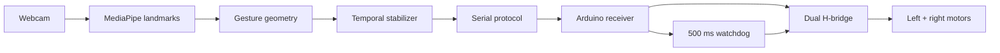

# Vision-Gesture Mobile Robot

[](https://github.com/VivekVRobo/gesture-controlled-robot/actions/workflows/python.yml)

A **webcam-controlled differential-drive mobile robot** using MediaPipe hand landmarks, orientation-aware gesture geometry, temporal command stabilization, serial control, and an Arduino-side watchdog.

> This is the **mobile-robot vision/control project**. For my physical wearable-controlled robotic arm, see [gesture-controlled-robotic-arm](https://github.com/VivekVRobo/gesture-controlled-robotic-arm).

> **Current status:** software/reference implementation validated with deterministic synthetic evidence. Real-camera recognition accuracy, end-to-end latency, serial reliability, motor direction, and physical robot motion remain unmeasured.

## Recruiter quick scan

| Area | Current implementation |
| --- | --- |
| Perception | MediaPipe hand landmarks |
| Gesture logic | Orientation-aware PIP joint + wrist-distance geometry |
| Safety behavior | Stable-frame gating for motion; STOP and hand-loss STOP are immediate |
| Transport | Rate-limited serial commands |
| Firmware fail-safe | Arduino stops motors if valid commands disappear for 500 ms |
| Software evidence | 120 deterministic landmark-rotation cases + transition/jitter tests in CI |
| Physical evidence | Pending |

## System path



## Gesture map

| Extended non-thumb fingers | Command |
| ---: | --- |
| 0 | Stop |
| 1 | Turn left |
| 2 | Turn right |
| 3 | Reverse |
| 4 | Forward |

The implementation avoids a simple `tip.y < PIP.y` rule because that breaks when the hand rotates in the image. Instead it combines joint geometry with wrist-distance relationships so the **ideal landmark construction** is less sensitive to in-plane rotation.

That does not imply real-camera invariance: occlusion, perspective, blur, lighting, landmark errors, and ambiguous poses still require real-data validation.

## Motion safety behavior

Movement commands are debounced across consecutive stable frames so one noisy classification does not immediately change robot motion.

Safety-critical stop behavior is not delayed:

```text
closed-fist STOP       -> immediate STOP
hand disappears        -> immediate STOP
program exits          -> forced STOP command
serial command loss    -> firmware watchdog stops motors after 500 ms
```

Computer vision is not treated as a physical emergency-stop mechanism. Real hardware testing should keep a separate power disconnect available.

## Quick start

```bash
python -m venv .venv
# Windows: .venv\Scripts\activate
# Linux/macOS: source .venv/bin/activate
pip install -e .
```

Dry-run first:

```bash
gesture-controlled-robot --dry-run
```

or:

```bash
python vision_control.py --dry-run
```

With an Arduino receiver connected:

```bash
gesture-controlled-robot --port COM5
# Linux example: --port /dev/ttyACM0
```

Firmware lives at:

[`firmware/robot_receiver/robot_receiver.ino`](firmware/robot_receiver/robot_receiver.ino)

## Deterministic software evidence

Run:

```bash
python tools/synthetic_gesture_evidence.py
```

The suite evaluates:

- 5 extended-finger counts;
- 24 in-plane rotations from 0° to 345°;
- 120 ideal-landmark geometry cases;
- single-frame command glitches;
- a stable legitimate command transition;
- immediate STOP on hand loss.

Generated evidence explicitly records:

```text
evidence_type: synthetic_gesture_geometry_and_stabilization_validation
hardware_evidence: false
real_camera_dataset: false
```

A perfect synthetic score validates the deterministic software contract only. It does **not** mean 100% real-world recognition accuracy.

## Testing

```bash
pip install -e . pytest
pytest -q
```

Tests cover gesture mapping, orientation-aware ideal-landmark classification, temporal stabilization, immediate STOP behavior, hand-loss handling, and serial command encoding.

## Evidence maturity

| Gate | State |
| --- | --- |
| Command mapping | ✅ tested |
| Ideal landmark geometry | ✅ tested |
| Temporal stabilization | ✅ tested |
| Immediate software STOP | ✅ tested |
| Serial encoding/rate limiting | ✅ tested |
| Synthetic evidence artifact | ✅ CI-generated |
| Real-camera confusion matrix | ❌ pending |
| Camera-to-command latency | ❌ pending |
| Serial reliability | ❌ pending |
| Physical mobile-robot motion | ❌ pending |
| End-to-end hardware latency | ❌ pending |

## Next meaningful proof

The next useful milestone is a real labeled camera dataset and a physical mobile-robot test, including confusion/error rates, stop detection, serial reliability, command-to-motion latency, watchdog behavior, and failure cases.

## Repository structure

```text
src/gesture_robot/
├── app.py
├── gestures.py
├── stabilizer.py
└── protocol.py

firmware/robot_receiver/robot_receiver.ino
tools/synthetic_gesture_evidence.py
tests/
docs/
vision_control.py
```

## License

MIT — see [`LICENSE`](LICENSE).
